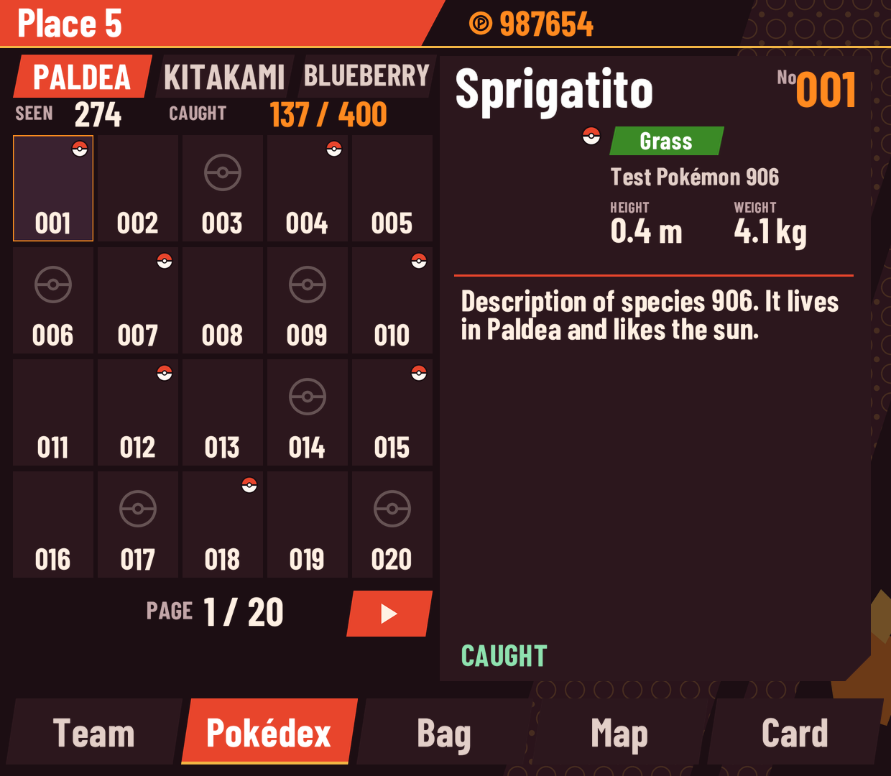
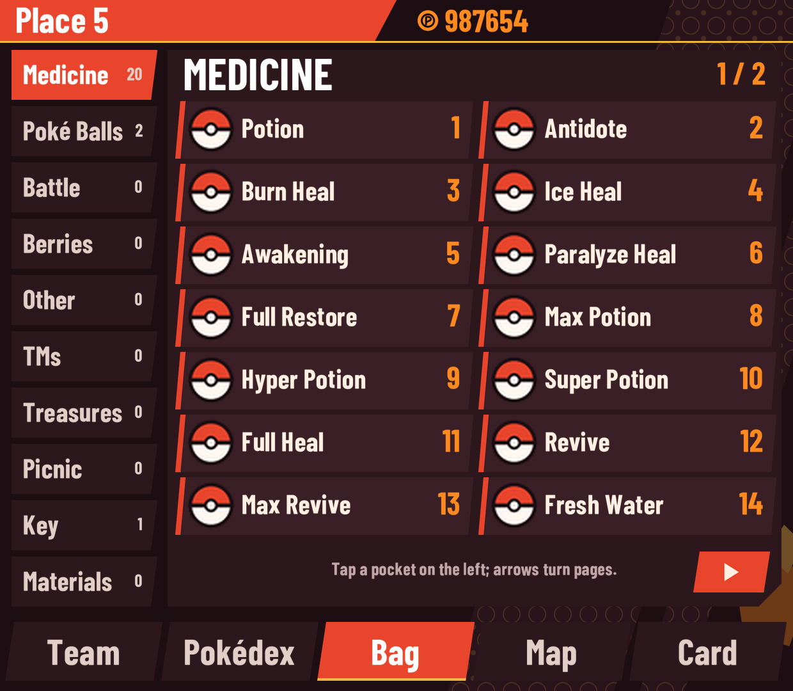

# Dual-screen companion for Pokémon Scarlet and Violet (Eden Duo)

A second-screen companion for **Pokémon Scarlet / Violet** on the **Eden Duo** emulator, built for
the AYN Thor and other dual-screen handhelds, in the spirit of the *Luminescent Platinum* companion.
It works with the original game and with mods such as **Pokémon Compass**.

**English and Spanish:** the interface follows your game's language automatically. You can also
choose it in Eden Duo's settings for the mod (**Language / Idioma**). · *[Leer en español](README.es.md)*

| Team | Battle |
|---|---|
|  |  |
| **Pokédex** | **Bag** |
|  |  |

*Screenshots made with `tools/preview.py` and test data. No Pokémon pictures are included: you
can add your own.*

## What it shows

- **Team**: cards with live HP, level, status and held item. Each Pokémon has a summary with its
  moves, stats, nature, Tera Type and matchups.
- **Battle** (opens by itself when a battle starts):
  - the opponent in large print, with HP, level, types and base stats compared with yours;
  - a **Tip**: who moves first and the best switch;
  - what hurts it (red), what it resists (green) and what has no effect (blue), with a
    **Terastallized?** button;
  - how effective your moves are, and **Switch suggestions**.
- **Pokédex**, **Bag** (with item icons taken from the game), **Map** (your position, zoom ×1–×8
  and facing) and **Trainer card** (time, date, battery, play time…).

The look is dark, with slanted panels and each game's colours. Scarlet has a wine-red background
with Paldea tiles, red, orange and the Academy's gold; Violet uses purple and lilac. A bar at the
top shows where you are, your money, the battery and the time. There is also a **light theme**:
use the **CHANGE THEME** button on the Card page or the **Theme** setting. Eden Duo remembers it.

In battle, the **CURSOR** button opens a guided search for the game's move-menu cursor
(experimental). Once found, the selected move is highlighted on the bottom screen.

Everything is **read-only**: the companion never changes the game's memory or your save.

## Language

| Setting (Eden Duo → the mod's settings) | Interface |
|---|---|
| **Auto** (default) | Spanish for Spanish games, English for every other language |
| **English** | always English |
| **Español** | always Spanish |

Game words (Pokémon, moves, items, abilities, places) always come from your own game files, so
they are in the game's language. Before your save is loaded, *Auto* shows English.

## How it finds the opponent

Scarlet and Violet don't keep the battling Pokémon anywhere known, and there are no published
pointers for version 3.0.x. The companion finds it like this:

1. **By its name on screen**: during a battle the game writes the opponent's name as text (HP bar,
   "A wild Skiddo appeared!"). The module looks for species names that appear when the battle
   starts, leaves out your team's and reads the "Lv. XX" that isn't yours. It remembers where the
   game writes them, so the next battle finds them at once.
2. **By its HP**: a Pokémon whose HP changes is the one in battle (useful against trainers).
3. **By hand**: the **Change** button opens a list of nearby Pokémon or **Search by name**, with
   an adjustable level.

The line under the opponent's card says how it was found. Technical details are in
[docs/HOW-IT-WORKS.md](docs/HOW-IT-WORKS.md).

## Requirements

- **Eden Duo** runtime 17 or later (time and date: runtime 16; battery and FPS: runtime 21).
- **Game version 3.0.0 or 3.0.1**:

  | Game | Title ID | 3.0.0 | 3.0.1 |
  |---|---|---|---|
  | Scarlet | `0100A3D008C5C000` | `C01884F294C053C4` | `421C5411B487EB4D` |
  | Violet | `01008F6008C5E000` | `E335DE2BF4DCD951` | `709BFD6611529864` |

Names, types, move data, icons and the map are read **from your own game files** (romfs) at run
time. The package ships no game assets.

## Installing

1. Download `Escarlata-vX.Y.Z.dsmod.zip` (Scarlet) or `Purpura-vX.Y.Z.dsmod.zip` (Violet) from
   [Releases](../../releases).
2. In Eden Duo: long-press the game → **Add-ons** → **Install** → **Dual screen mods** → pick the
   `.dsmod.zip`. A new version replaces the old one.

## Building

You need `clang`, `lld`, `llvm-strip` and Python 3 (standard library only):

```sh
./build.sh            # makes dist/Escarlata-v<VERSION>.dsmod.zip and dist/Purpura-v<VERSION>.dsmod.zip
```

The native module is freestanding C (no libc, no NDK), built for `android-arm64-v8a` and
`linux-x86_64`. The pages are generated by `tools/gen_manifest.py` (with the English/Spanish
text table) and the art by `tools/make_art.py` (needs Pillow; the generated art is in `art/`).

**Your own start screen (optional):** put a 1240×1080 image in `art/splash_s.png` and Scarlet
uses it as its start screen. The repository doesn't include one; without it both games use the
generated start screen.

`tools/preview.py` draws a page from a dump of values, without a console.
`native/test_host.c` is a fake host with simulated memory that tests the whole module (reading
the save, battles, name detection, map, both languages…). It needs a copy of
[PKHeX](https://github.com/kwsch/PKHeX) for its test PK9 files, and `tools/make_test_romfs.py`
to build a synthetic romfs (`--english` for an English one).

## Credits

- Save and PK9 formats: [PKHeX](https://github.com/kwsch/PKHeX) (kwsch and contributors).
- Block keys and SV structures: [SVResearches](https://github.com/Manu098vm/SVResearches).
- romfs paths: [PokeDocs](https://github.com/pkZukan/PokeDocs) (SV hash list).
- Map scale: [RaidCrawler](https://github.com/LegoFigure11/RaidCrawler).
- Map-state pointer: [SysBot.NET](https://github.com/kwsch/SysBot.NET).
- Idea and style: the *Luminescent Platinum* companion for Eden Duo.
- Bundled libraries: see [THIRD_PARTY.md](THIRD_PARTY.md).

## Licence and disclaimer

Code under **GPL-3.0-or-later** ([LICENSE](LICENSE)). A non-profit fan project, not affiliated
with Nintendo, Game Freak, Creatures or The Pokémon Company. Pokémon and its names are trademarks
of their respective owners. No game files are distributed: you need your own copy of the game.
