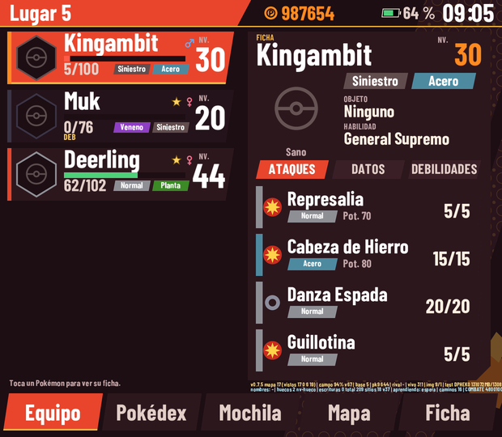
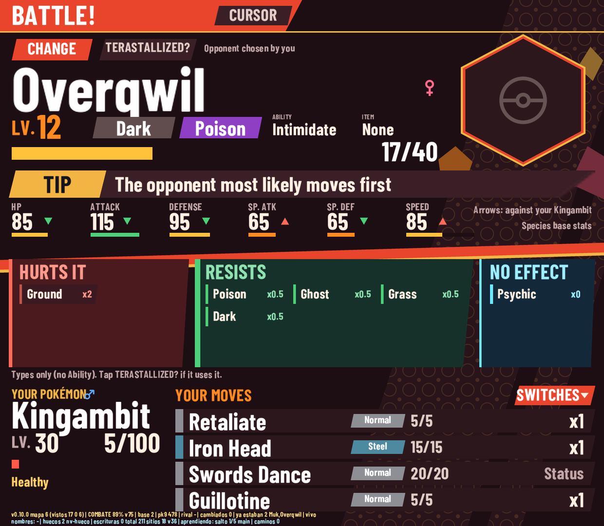

# Companion de doble pantalla para Pokémon Escarlata y Púrpura (Eden Duo)

Pantalla inferior para **Pokémon Escarlata / Púrpura** en el emulador **Eden Duo** (pensado para la
AYN Thor y otras consolas de dos pantallas), al estilo del companion de *Luminescent Platinum*.
Funciona con el juego original y con mods como **Pokémon Compass**.

*English summary at the end.*

| Equipo | Combate |
|---|---|
|  |  |
| **Pokédex** | **Mochila** |
|  |  |

*Capturas generadas con `tools/preview.py` y datos de prueba (sin imágenes de Pokémon: esas las
pones tú).*

## Qué muestra

- **Equipo**: tarjetas con PS, nivel, estado y objeto en directo; ficha de cada Pokémon con
  movimientos, estadísticas, naturaleza, teratipo y debilidades.
- **Combate** (cambia solo al empezar un combate):
  - el rival en grande, con PS, nivel, tipos y estadísticas base frente a las tuyas;
  - un **Consejo**: quién actúa primero y el mejor cambio;
  - lo que le hace daño (rojo), lo que aguanta (verde) y lo que no le afecta (azul), con botón
    **¿Teracristal?**;
  - eficacia de tus movimientos y **Sugerencias de cambio**.
- **Pokédex**, **Mochila** (con los iconos de los objetos sacados del juego), **Mapa** (tu posición,
  zoom ×1–×8 y orientación) y **Ficha de entrenador** (hora, fecha, batería, tiempo de juego…).

Aspecto oscuro con paneles en diagonal y el color de cada juego: en Escarlata, fondo vino con
azulejos de Paldea, rojo, naranja y el dorado de la Academia; en Púrpura, morado y lila. Una barra
arriba muestra el lugar, el dinero, la batería y la hora. También hay un **tema claro**: botón **CAMBIAR TEMA** en la Ficha
(Eden Duo lo recuerda).

En combate, el botón **CURSOR** abre una búsqueda guiada de la posición del cursor del menú de
ataques del juego (experimental): cuando la encuentra, el ataque marcado se resalta abajo.

Todo es **solo lectura**: el companion nunca modifica la memoria ni la partida.

## Cómo detecta al rival

Escarlata y Púrpura no guardan el Pokémon del combate en ningún sitio conocido, y no hay punteros
publicados para la versión 3.0.x. El companion lo detecta así:

1. **Por su nombre en pantalla**: durante el combate el juego escribe el nombre del rival como
   texto (barra de vida, «¡Un Skiddo salvaje te ha salido al paso!»). El módulo busca nombres de
   especie que aparecen nuevos al empezar el combate, descarta los de tu equipo y lee el «Nv. XX»
   que no es el tuyo. Recuerda dónde los escribe el juego para encontrarlos al instante en el
   siguiente combate.
2. **Por sus PS**: un Pokémon cuya vida cambia es el que está en combate (sirve para entrenadores).
3. **A mano**: botón **Cambiar** → lista de Pokémon cercanos o **Buscar por nombre**, con el nivel
   ajustable.

Debajo de la ficha del rival se indica cómo se ha encontrado. Los detalles técnicos están en
[docs/COMO-FUNCIONA.md](docs/COMO-FUNCIONA.md).

## Requisitos

- **Eden Duo** con runtime 17 o posterior (hora y fecha: runtime 16; batería y FPS: runtime 21).
- **Juego en versión 3.0.0 o 3.0.1**:

  | Juego | Title ID | 3.0.0 | 3.0.1 |
  |---|---|---|---|
  | Escarlata | `0100A3D008C5C000` | `C01884F294C053C4` | `421C5411B487EB4D` |
  | Púrpura | `01008F6008C5E000` | `E335DE2BF4DCD951` | `709BFD6611529864` |

Los nombres, tipos, datos de movimientos, iconos y el mapa se leen **de tus propios archivos del
juego** (romfs), en el idioma de tu partida. El paquete no incluye ningún recurso del juego.

## Instalación

1. Descarga `Escarlata-vX.Y.Z.dsmod.zip` o `Purpura-vX.Y.Z.dsmod.zip` de
   [Releases](../../releases).
2. En Eden Duo: mantén pulsado el juego → **Add-ons** → **Install** → **Dual screen mods** → elige
   el `.dsmod.zip`. Una versión nueva sustituye a la anterior.

## Compilar

Hace falta `clang`, `lld`, `llvm-strip` y Python 3 (solo la biblioteca estándar):

```sh
./build.sh            # crea dist/Escarlata-v<VERSION>.dsmod.zip y dist/Purpura-v<VERSION>.dsmod.zip
```

El módulo nativo es C freestanding (sin libc ni NDK) y se compila para `android-arm64-v8a` y
`linux-x86_64`. El diseño de las páginas se genera con `tools/gen_manifest.py` y el arte con
`tools/make_art.py` (necesita Pillow; el arte ya generado está en `art/`).

**Portada propia (opcional):** si pones una imagen de 1240×1080 en `art/splash_s.png`, Escarlata la
usa como pantalla de inicio. El repositorio no la incluye; sin ella, los dos juegos usan la
pantalla de inicio generada.

`tools/preview.py` dibuja una página a partir de un volcado de valores, sin consola.
`native/test_host.c` es un host falso con una memoria simulada que prueba el módulo entero
(lectura de la partida, combates, detección por nombre, mapa…); necesita una copia de
[PKHeX](https://github.com/kwsch/PKHeX) para sus PK9 de prueba y `tools/make_test_romfs.py`
para generar un romfs sintético.

## Créditos

- Formatos de la partida y de los PK9: [PKHeX](https://github.com/kwsch/PKHeX) (kwsch y
  colaboradores).
- Claves de bloques y estructuras de SV: [SVResearches](https://github.com/Manu098vm/SVResearches).
- Rutas del romfs: [PokeDocs](https://github.com/pkZukan/PokeDocs) (lista de hashes de SV).
- Escala del mapa: [RaidCrawler](https://github.com/LegoFigure11/RaidCrawler).
- Puntero del estado del mapa: [SysBot.NET](https://github.com/kwsch/SysBot.NET).
- Idea y estilo: el companion de *Luminescent Platinum* para Eden Duo.
- Bibliotecas incluidas: ver [THIRD_PARTY.md](THIRD_PARTY.md).

## Licencia y aviso

Código bajo **GPL-3.0-or-later** ([LICENSE](LICENSE)). Proyecto de fans sin ánimo de lucro, sin
relación con Nintendo, Game Freak, Creatures ni The Pokémon Company. Pokémon y sus nombres son
marcas de sus respectivos propietarios. No se distribuye ningún archivo del juego: necesitas tu
propia copia.

---

## English summary

A second-screen companion for **Pokémon Scarlet / Violet** (v3.0.0 and v3.0.1) on the
**Eden Duo** emulator: live party, battle screen (rival detected from the names the game
writes on screen, type matchups, switch suggestions), Pokédex, bag, map with live position and
trainer card, in a dark slanted look with each game's colours. Read-only. Game data is read from your own romfs at runtime; nothing from the game
is shipped. Build with `./build.sh` (clang + lld + Python 3). Licensed GPL-3.0-or-later.
